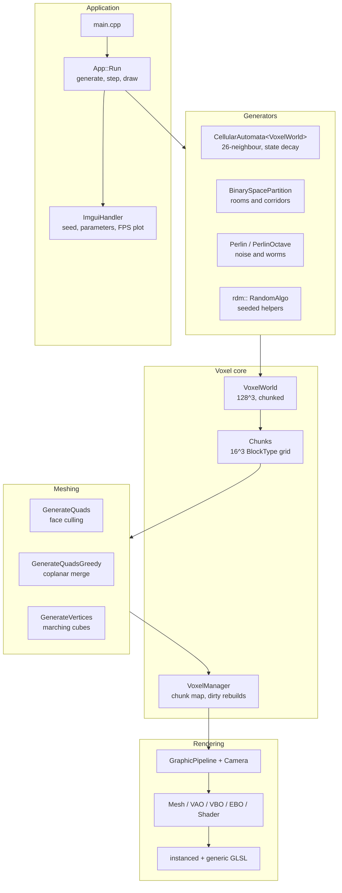
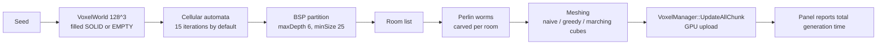

<div align="center">

# Procedural Cave Generation

**A 2-million-voxel cave laboratory in C++ and OpenGL — 3D cellular automata, BSP room partitioning and Perlin worms, composed live, with greedy meshing and marching cubes to turn the result into geometry you can fly through.**


<sub>Two caves from the same program: the voxel view and the meshed view. Every parameter behind them is a slider in the ImGui panel, and the whole 128&times;128&times;128 world regenerates on one button press.</sub>

</div>

---

## At a glance

- **A 128&times;128&times;128 world — 2,097,152 voxels** — split into 16&sup3; chunks and regenerated from a seed on demand.
- **Four generation algorithms that compose**, rather than one hard-coded pipeline: cellular automata, binary space partitioning, Perlin noise and Perlin worms, each independently toggleable.
- **Three meshing strategies** behind one flag — naive face culling, greedy quad merging, and marching cubes with the full 256-entry edge/triangle tables.
- **Everything is live.** Seed, CA birth/survival ranges, iteration count, BSP depth and balance, noise scale, octaves and threshold are all ImGui sliders; a rolling 90-sample FPS plot and the last generation time sit at the bottom of the panel.
- **Step-through mode** runs the cellular automaton one iteration at a time on a worker thread, so you can watch the cave carve itself out instead of only seeing the result.
- ~3,500 lines of first-party C++ — the voxel core, the generators and a small OpenGL layer (VAO/VBO/EBO, shaders, instanced draws) written by hand.

---

## Highlights

**Cellular automata in three dimensions, with decay.**
The usual cave CA is 2D with a live/dead cell. `CellularAutomata.h` runs over all 26 Moore neighbours in 3D and gives each cell a *state* from 0 to `maxState`: a cell that fails its survival range does not die outright, it decrements one step per iteration. That linear decay is what keeps walls from flickering into existence and erodes them smoothly instead, and `inverted` plus `sphereMode` turn the same rule into either solid-in-void or void-in-solid caves.

**Three algorithms layered, not chosen.**
`App::Run` composes them in order: the CA carves the organic bulk, BSP partitions the volume into rooms, then octave Perlin noise (the "Perlin Worm" pass) carves within *each room's* bounds rather than across the whole world. Running one generator over the sub-volumes produced by another is what stops the output looking like pure noise or pure level design. Any stage can be switched off from the panel to see what it was contributing.

**Three ways to turn voxels into triangles.**
`Voxel.cpp` implements all three and they are a fair comparison because they share the same chunk data: `GenerateQuads` emits one quad per exposed face, `GenerateQuadsGreedy` merges coplanar runs into larger quads, and `GenerateVertices` runs marching cubes against the standard `edgeTable` / `triTable` for a smooth isosurface. Blocky voxel draws go through an instanced quad; marching-cube output goes through a batched mesh.

**Watching the simulation, not just the output.**
With *Simulate Steps* on, each CA iteration is dispatched to a detached thread and the chunk meshes are rebuilt when it completes, so the render loop keeps running at full rate while the automaton advances one generation at a time.

---

## Architecture



One press of **Generate Cave**:



### Repository layout

| Path | Contents |
| --- | --- |
| `Project1/Algorithms/` | `CellularAutomata`, `BinarySpacePartition`, `Perlin`, `RandomAlgo`, and the voxel core (`Voxel`, `VoxelWorld`) |
| `Project1/Graphics/` | `GraphicPipeline`, `Camera`, `Mesh`, `Shader`, `VAO`/`VBO`/`EBO`, `DrawShapes`, GLSL shaders |
| `Project1/Application/` | `main.cpp`, `App` (generation + render loop), GLFW `Window` |
| `Project1/Imgui/` | ImGui setup and frame handling |
| `Project1/Dependencies/` | Vendored GLFW, GLEW, GLM and ImGui |

---

## The parameters, and what they do

All of these are live sliders — the panel is the experiment.

<details>
<summary><b>Cellular automata</b></summary>

| Parameter | Default | Effect |
| --- | --- | --- |
| `initialFillProb` | 0.26 | Fraction of cells seeded alive before the first iteration |
| `birthMin` / `birthMax` | 12 / 26 | Live-neighbour range (of 26) in which a dead cell is born |
| `survivalMin` / `survivalMax` | 10 / 26 | Range in which a live cell keeps its state; outside it, the state decays by 1 |
| `maxState` | 5 | How many iterations a cell survives while decaying |
| `iterationCount` | 15 | Generations to run |
| `inverted` | off | Swap solid and empty — caves in rock, or rock in caves |
| `sphereMode` | off | Seed only a central sphere instead of the whole volume |

</details>

<details>
<summary><b>Binary space partitioning</b></summary>

| Parameter | Default | Effect |
| --- | --- | --- |
| `minSize` | 25 | A region below this size is not split further |
| `maxDepth` | 6 | Recursion limit, so at most 2<sup>6</sup> leaf rooms |
| `balance` | 0.3 | How far off-centre a split cut may fall |

</details>

<details>
<summary><b>Perlin noise and worms</b></summary>

| Parameter | Default | Effect |
| --- | --- | --- |
| `scale` | 4.0 | Noise frequency — lower means wider features |
| `threshold` | 0.75 | Carving cutoff — lower leaves less empty space |
| `octave` | 1 | Number of summed noise octaves |
| `octavePersistence` | 1.0 | Amplitude falloff per octave |
| `generateSolid` | off | The noise pass deposits material instead of carving it |

(`wormCount` and `wormRadius` exist in `WormParams` but are not yet read by `GeneratePerlin`.)

</details>

---

## Getting started

### Requirements

- Windows 10/11
- Visual Studio 2022

GLFW, GLEW, GLM and ImGui are vendored under `Project1/Dependencies/` — there is nothing to install.

### Build and run

```bash
git clone https://github.com/jazwinn/Procedural-Cave-Generation.git
cd Procedural-Cave-Generation/Project1
```

Open `Project1.sln` in Visual Studio 2022, build, and run. Then:

1. Set a **Seed** (or press **Random**).
2. Tick the algorithms you want under **Algorithms**.
3. Press **Generate Cave**.
4. Fly the camera through the result; the **Performance** header shows the generation time and a rolling FPS plot.

Turn on **Simulate Steps** under *Cellular Automata* before generating to watch the automaton iterate instead of jumping to the final state.

---

## Known limitations

- **Windows and Visual Studio only.** The code itself is portable OpenGL, but the project is a `.sln` with prebuilt `.lib` files, not CMake.
- **Generation is single-threaded** apart from the stepped CA mode. A full 128&sup3; CA run visits ~2.1M cells &times; 26 neighbours per iteration on one core; the panel's timer makes the cost visible, and chunk-parallel evaluation is the obvious fix.
- **Marching cubes meshes the whole world at once** rather than per dirty chunk, so toggling it is noticeably slower than the voxel paths.
- **The BSP corridor pass is minimal** — rooms are carved and worms connect them, but there is no guarantee every room is reachable.
